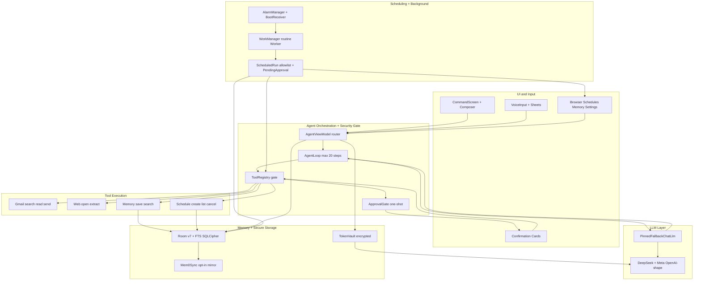

# AIRA architecture

ADRs 0001–0005 decide the
closed questions. Boundaries: UI renders state and collects
approvals; `AgentLoop`/`AgentViewModel` orchestrate; Tools own schemas,
risk, `requiresConfirmation`, and executors; Memory is Room via
`MemoryStore` only; Scheduler is exact alarm → expedited unique Worker →
agent loop, receivers doing no DB work.

## Data / control flow

Verified: Room v7 + FTS + SQLCipher, DeepSeek and Meta only (no Groq, no Gemini provider, no Supermemory), Mem0 opt-in mirror with Room as source of truth. Every `send_email` and Schedule write passes `ApprovalGate`; `execute()` refuses gated Tools outright.

## 1. Agent loop and tool calling (ADR-0005)

`AgentLoop` keeps a messages list (`system` with the injection-framing
preamble + delimited `[memories]` section, `user`, `assistant` with tool
calls, `role:"tool"` results matched by `tool_call_id`). It repeats
LLM → `executeGated` → append result until a plain answer, max 20 steps,
per-step 90 s / total 5 min timeouts → `Failed` with partial steps kept.
Tool errors return `{ok:false, error, retryable}` so the model recovers;
unknown tools and schema violations fail the same way. 13 tools are
LLM-visible with JSON schema, risk level, `requiresConfirmation`, result
type. Events (`StepStarted`, `ToolRunning`, `NeedsApproval`, `StepDone`,
`Failed`) feed the timeline UI.

## 2. Scheduling and background work (ADR-0002)

`setExactAndAllowWhileIdle` at the next cron time → `AlarmReceiver`
enqueues an expedited unique Worker (`REPLACE`) → Worker runs the headless
loop → re-arm enqueued in the same receiver and on
BOOT/TIMEZONE/TIME_SET. No WorkManager periodic work; no DB on receiver
threads. Revoked `SCHEDULE_EXACT_ALARM` falls back to inexact with a
persistent Settings prompt; battery-optimization prompt + OEM autostart
guidance live in Settings (`BatteryDoze.kt`). Runs are recorded in
`schedule_runs` keyed by scheduleId + fireTime (idempotent); expired Gmail
tokens post "Reconnect Gmail" instead of failing silently.

## 3. Memory and retrieval (ADR-0001; #32 cut)

Room-only via `MemoryStore` (`RoomMemoryStore` is the only wiring; `Outbox`
deleted). Row: `category, importance, createdAt, lastUsed, useCount`.
Recall = keyword overlap, ties broken by importance, then recency
(`max(lastUsed, createdAt)`), then insertion order; offline path is an FTS
`MATCH 't*'` prefix AND with the same boosts. `save_memory` /
`search_memory` are LLM tools; the shipped path trims to `max_results`
(top-k) before rendering the prompt section (~100× smaller, ~50× faster -
`docs/PERF_TIMINGS.md`). **Embeddings (#32) are cut**: no embedding column,
no cosine, no cache.

## 4. LLM providers and fallback (ADR-0004, re-amended #46)

DeepSeek (`deepseek-flash`) default with Meta (`muse-spark-1.3`) fallback over one
OpenAI-shape OkHttp client (connect 15 s, read 60 s, backoff honouring
`retry-after`). Fallback triggers on 429/5xx (never 401), never silently
mid-conversation with private context - the UI shows "retried on Y" from
`providersTried`. No key → Room + app still work. The Command screen
provider sheet switches the runtime override (`selectedProvider`, `null`
= Auto/Default); `BuildConfig.LLM_DEFAULT_PROVIDER` remains the fallback.
User-entered keys live in `TokenVault`, set/not-set flags only in state.

## 5. Confirmation, injection defence, unattended runs (ADR-0003)

Confirmation is per sensitive tool call, never per Plan: `send_email`,
`create_schedule`, `cancel_schedule` set `requiresConfirmation`; the gate
in `ToolRegistry.executeGated` suspends the loop until the UI returns
approve / edited-approve / reject / timeout, and reject/timeout yield
`{status:"cancelled_by_user"}` without running the executor. `execute()`
refuses gated tools outright, so the model has no path around the gate; a
deterministic `SendPolicy` re-checks before `send_email`. Email/page text
travels only inside source-tagged, JSON-encoded tool results; the system
prompt declares tool content data, never instructions; memories sit in the
delimited section, never concatenated into the user message. Per-recipient
`AllowAlways` `Preference` rows let the user pre-approve a recipient once;
the bounded creation-time `ScheduledSendConsent` amendment (ADR-0002/0003)
lets an exact-match templated send run headless, with any drift held as a
`PendingApproval`. `save_memory` calls made after an untrusted external
read are source-sanitized (`UNTRUSTED_EXTERNAL_READ_TOOLS`,
`sanitizeMemoryCallForUntrustedRun` in `MemoryTools.kt`), so
attacker-influenced runs cannot plant trusted memories. Scheduled runs
hold only the 5 read tools - a send or write becomes a `PendingApproval`
row + notification, approved in-app. Red-team tests (evil-forward +
memory-poisoning, foreground card vs scheduled hold) are the acceptance
criterion.

## 6. UI, state, and secrets

Compose screens (Onboarding, Command, Browser, Schedules, Memory,
Settings) plus the `SideDrawer` (`Sessions` with search and `New Session`)
render `AgentUiState` and forward events; they never execute tools or hold
keys (key fields show set/not-set flags and clear after save). The Command
screen additionally keeps a scrollable Room v6 persisted `Interaction` feed
with settled Confirmation receipts; `Sessions` hydrate their transcripts on
cold start. `AgentViewModel` owns
state, including live `PerfTimings` (`planMs`/`toolMs`/`recallMs`) shown
in Settings alongside 1-tap System Diagnostics. Shared text arriving via
the `ACTION_SEND` Share Sheet target routes into the Command composer;
launcher shortcuts (`shortcuts.xml`) deep-link voice, new Session, and
Schedules; the current Session exports as Markdown via share/copy. Gmail
tokens and
user-entered LLM keys live in `TokenVault` (EncryptedSharedPreferences,
Keystore-backed; `security-crypto:1.1.0` deprecated-but-working - see
`SECURITY.md`). `allowBackup="false"` + `data_extraction_rules` deny all
backup/transfer domains. Release ships `app/proguard-rules.pro` (Tink,
Room, WorkManager, OkHttp/Jsoup keeps) wired into the `release` build
type. Debug keys come from git-ignored
`local.properties`; release `BuildConfig` key fields are empty.
