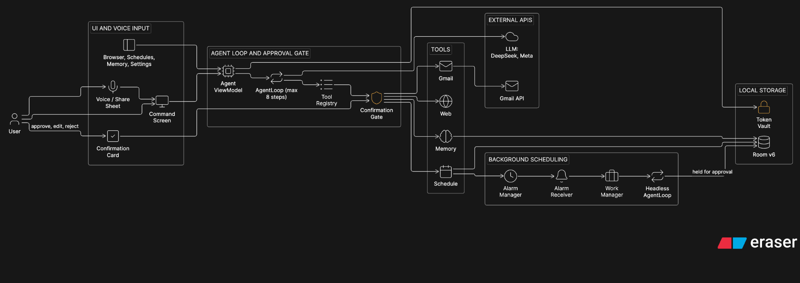

# AIRA

AIRA is a local-first Android AI agent that turns voice and text commands into real actions. It plans with an LLM, executes through a confirmation gate, and remembers context across sessions.

[](.github/workflows/check.yml)   

`TBD` · [Architecture](ARCHITECTURE.md) · [Security](SECURITY.md) · [Performance](docs/PERF_TIMINGS.md) · [Scheduling Proof](docs/SCHEDULING_TEST.md)

> Demo Video: [google drive link](https://drive.google.com/file/d/1QLlgzsOX3_gwSiIWV5ctNdg1P2n2hrS2/view?usp=sharing)

## Features & Available Tools

- **Voice & text commands** - speak or type a request; the agent plans the steps and runs them.
- **Persistent memory** - Room with full-text search, encrypted with SQLCipher, plus an opt-in Mem0 cloud mirror.
- **Real-world actions** - Gmail triage, in-app WebView automation (open, read, click, scroll, extract), and multi-step chaining across tools.
- **Scheduled tasks** - describe a routine in natural language; it runs on time via AlarmManager plus WorkManager.
- **Confirmation gate** - sensitive actions pause for your approval before anything happens.

| Area | Tools | Needs confirmation |
|---|---|---|
| Gmail | `search_emails`, `read_email`, `send_email` | `send_email` only |
| Schedules | `create_schedule`, `list_schedules`, `cancel_schedule` | `create_schedule`, `cancel_schedule` |
| Memory | `save_memory`, `search_memory` | - |
| Web | `open_url`, `get_page_text`, `click`, `scroll`, `extract` | - |

Background scheduled runs are restricted to a read-only allowlist (`search_emails`, `read_email`, `get_page_text`, `search_memory`, `list_schedules`). Anything that sends or changes state becomes a pending approval instead of executing.

## Setup & Build

Prerequisites: **Java 17**, Android SDK with **compileSdk 35** (`minSdk 26`).

```bash
cp local.properties.sample local.properties   # then fill in your keys
./gradlew :app:testDebugUnitTest               # 659 unit tests
./gradlew :app:installDebug                    # install on an attached device/emulator
./gradlew :app:assembleDebug :app:assembleRelease
```

- DeepSeek is the default provider with Meta as fallback; add both keys to `local.properties`.
- Mem0 is optional and off by default - only needed for the cloud memory mirror.
- Release builds strip build-time keys, so release users enter keys in-app under Settings (stored in EncryptedSharedPreferences).

`app-release-unsigned.apk` is unsigned - install `app-debug.apk` directly or sign the release build yourself.

## Architecture & Security



Full flow: [ARCHITECTURE.md](ARCHITECTURE.md) ([diagram source](docs/architecture.mmd)).

- Modular loop (`AgentViewModel` → `AgentLoop` → gated `ToolRegistry` → Gmail/schedule/memory/web adapters) with Room as the single source of truth.
- Keys in the Keystore, database encrypted with SQLCipher, per-call confirmation for sensitive tools, and a CI secret scan before tests. Details: [SECURITY.md](SECURITY.md).

## Testing & Performance

| Check | Result | Proof |
|---|---|---|
| Unit tests | **659 tests / 55 classes, 0 failures** | [TEST_PLAN.md](TEST_PLAN.md) |
| On-device scheduling | Exact-alarm → Worker chain verified on hardware | [docs/SCHEDULING_TEST.md](docs/SCHEDULING_TEST.md) |
| Performance | Timing and memory analysis | [docs/PERF_TIMINGS.md](docs/PERF_TIMINGS.md) |
| CI pipeline | Secret scan → unit tests → assemble → lint | [.github/workflows/check.yml](.github/workflows/check.yml) |

## AI Development Tools

AI coding tools were used to accelerate development and test coverage, directed through written specs and decision records in `docs/adr/`. All output was verified with the 659-test JUnit suite (`TEST_PLAN.md`) plus physical Android hardware runs recorded in `docs/SCHEDULING_TEST.md` and `docs/BROWSER_TEST.md`.

## Project Structure

```
app/src/main/java/com/aira/agent/
  AgentLoop.kt, LlmProvider.kt          # planning loop + providers
  ToolRegistry.kt, *Tools.kt           # confirmation gate + tool adapters
  Memory*.kt, AppDbCipher.kt           # encrypted Room memory store
  Schedule*.kt                         # alarms, worker, run history
  Gmail*.kt, Web*.kt, VoiceInput.kt    # platform integrations
  ui/                                  # screens, sheets, components, theme
app/src/test/                          # 55 test classes, 659 tests
docs/adr/                              # architecture decision records
```
